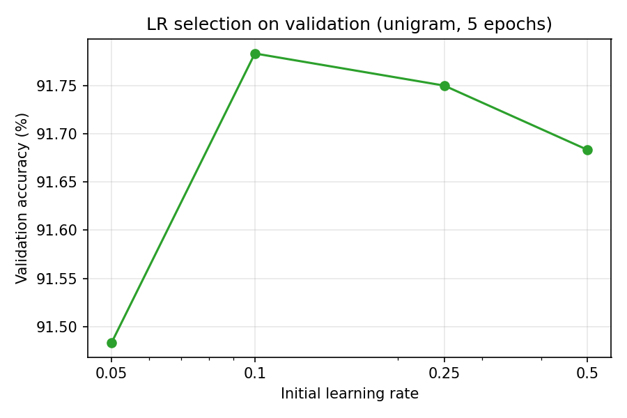
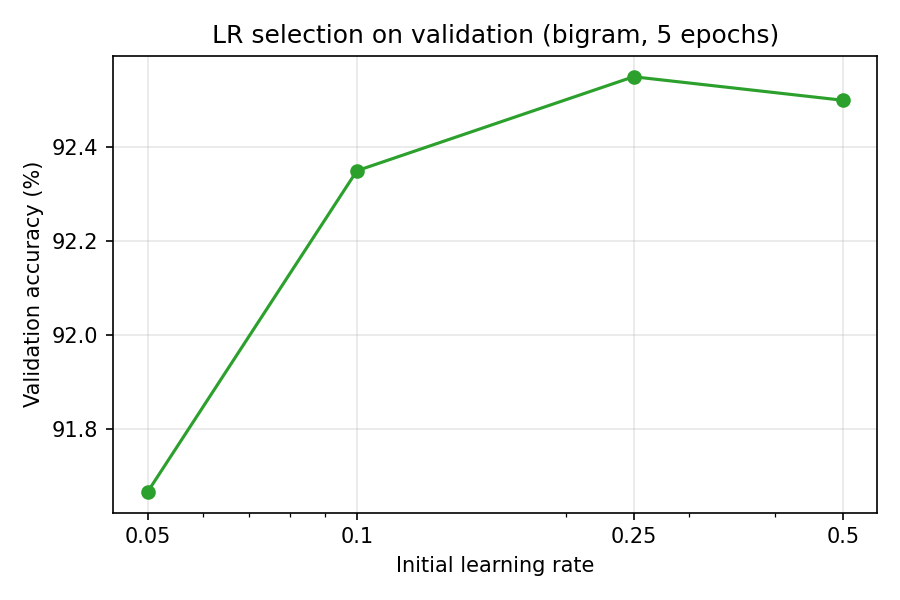
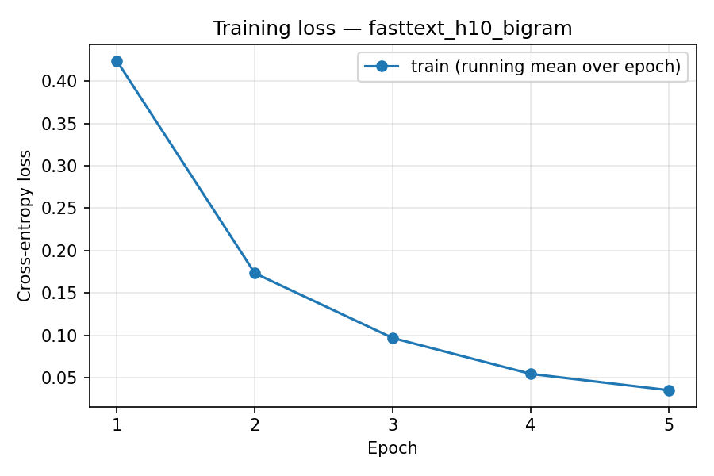
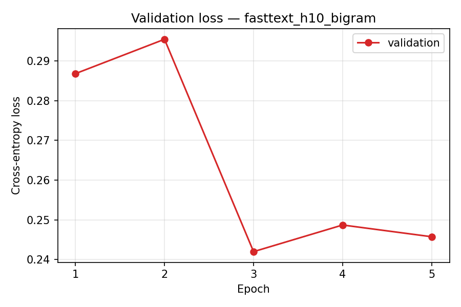
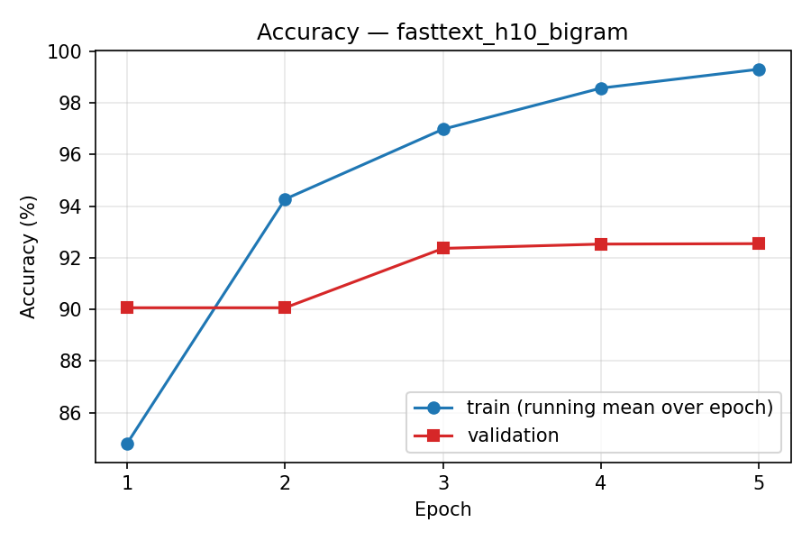
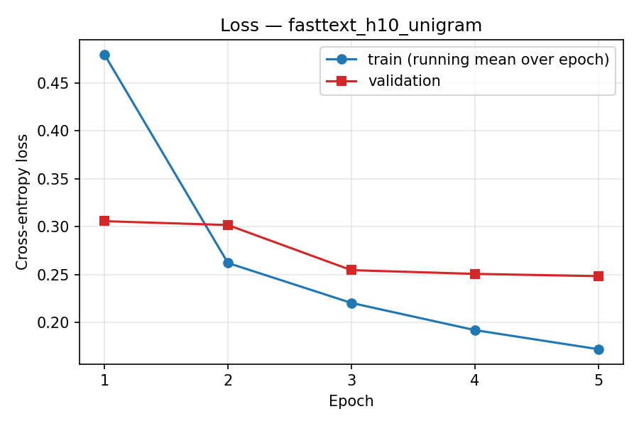
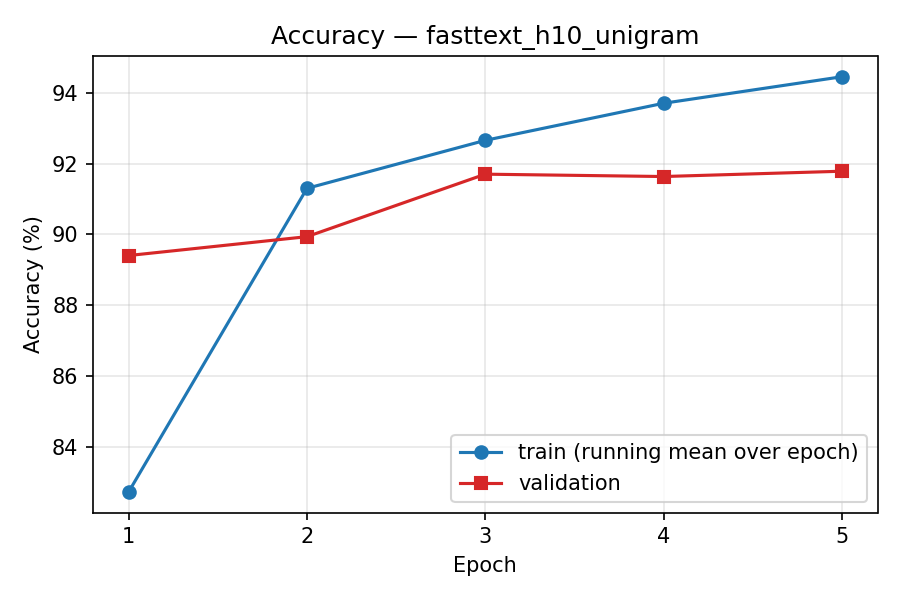
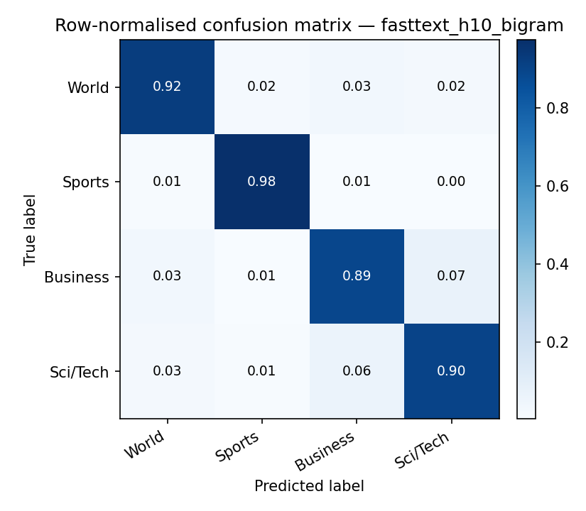
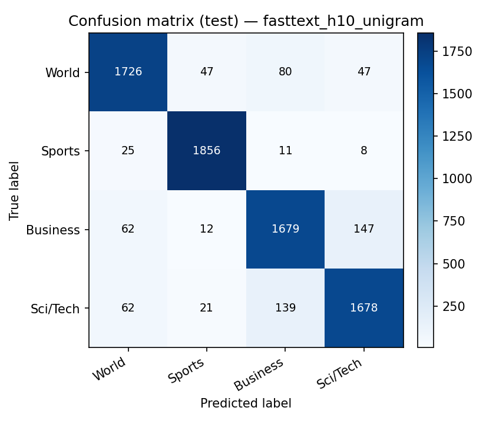

# Reproducibility Report: "Bag of Tricks for Efficient Text Classification" on AG News

*Generated automatically by `src/report.py` from the files in `results/metrics/`. All reproduced
numbers below come from the experiment logs of this repository; the original numbers are taken from
Table 1 and Table 2 of arXiv:1607.01759v3.*

---

## 1. Introduction

Text classification is one of the most common tasks in natural language processing: spam filtering,
topic labelling, sentiment analysis and intent detection all reduce to it. By 2016 the strongest
reported results on the standard large-scale benchmarks of Zhang et al. (2015) came from deep
convolutional and recurrent networks operating on characters or words, which needed GPUs and hours of
training per epoch. Joulin, Grave, Bojanowski and Mikolov (2016) argued that a carefully engineered
*linear* model, with a low-rank constraint, averaged word and n-gram embeddings, and a handful of
efficiency "tricks", reaches accuracy on par with these networks while training several orders of
magnitude faster on a CPU. Their method was released as the fastText library.

This report documents an independent re-implementation of that classifier in PyTorch and its evaluation
on the AG News topic-classification benchmark, one of the eight datasets in Table 1 of the paper. The goals
are (i) to check whether the reported AG News test accuracies (**91.5%** without and **92.5%** with bigrams)
can be obtained from the published description and the official scripts, (ii) to quantify every
deviation from the original setup, and (iii) to package the experiment so that it can be re-run end to
end on a CPU-only Google Colab instance and resumed after a disconnect.

The report is organised as follows. Section 2 summarises the paper; Sections 3–5 describe the method,
the implementation and the experimental setup; Sections 6–7 present the reproduced results and compare
them with the original ones; Section 8 discusses sources of discrepancy, and Sections 9–10 list
limitations and conclude.

## 2. Paper Overview

**Model.** A document is represented as a bag of features (words and, optionally, word n-grams). Each
feature indexes a row of an embedding matrix *A*; the rows are averaged into a hidden document
representation of size *h*, which is fed to a linear classifier *B* followed by a softmax. Training minimises
the negative log-likelihood

  −(1/N) Σₙ yₙ log(f(B A xₙ)),

where *xₙ* is the normalised bag of features of document *n*. The model is therefore a linear classifier
whose weight matrix is factorised into *B·A* (rank ≤ *h*), which lets parameters be shared across features
and classes. It is trained with stochastic gradient descent and a linearly decaying learning rate,
asynchronously on multiple CPU threads.

**Tricks.** (1) A *hierarchical softmax* based on a Huffman tree reduces the cost of the output layer from
O(kh) to O(h log₂ k) for *k* classes — important for tag prediction with hundreds of thousands of labels,
irrelevant for the 4 classes of AG News. (2) *N-gram features* add local word-order information that a pure
bag of words lacks. (3) The *hashing trick* (Weinberger et al., 2009) maps n-grams into a fixed number of
buckets (10M when only bigrams are used) instead of storing an explicit n-gram vocabulary.

**Experiments on AG News.** The sentiment/topic experiments use *h* = 10 hidden units, 5 epochs, and an
initial learning rate selected on a validation set from {0.05, 0.1, 0.25, 0.5}. Table 1 of the paper
reports AG News test accuracy of **91.5%** for fastText (h=10) and **92.5%** for fastText (h=10, bigram),
compared with 87.2% for char-CNN, 91.4% for char-CRNN and 91.3% for VDCNN. Table 2 reports a training
time of **1 s per epoch** on AG News for the bigram model (CPU, 20 threads) versus 1–3 h for char-CNN and
24–51 min for VDCNN on a Tesla K40 GPU.

**Official implementation.** The script `classification-results.sh` in the fastText repository reproduces
Table 1. For AG News it lowercases and tokenises the CSV files with a `sed` pipeline and runs
`fasttext supervised -dim 10 -lr 0.25 -wordNgrams 2 -minCount 1 -bucket 10000000 -epoch 5 -thread 4`.
It does not pass `-loss`, so the default (full) softmax is used. The script notes that its learning rates
"were chosen by validation on a subset of the training set".

## 3. Methodology

Our reproduction follows the paper and the official script step by step:

1. **Data.** The original AG News CSV files of Zhang et al. (2015): 120,000 training and 7,600 test
   documents, 4 balanced classes (World, Sports, Business, Sci/Tech). Each document is a title plus a
   short description. File integrity is verified with SHA-256 and row counts.
2. **Normalisation.** The official `normalize_text` function is reproduced exactly (ASCII lowercasing,
   separating `. , ( ) ! ?` and apostrophes, removing quotes, `;` and `:`). Because the official script
   operates on the raw CSV line, the field separators become `,` tokens; we reproduce this too.
3. **Features.** Unigrams from a training-set vocabulary (minCount = 1) plus an end-of-line token
   `</s>`. In the bigram model, every pair of consecutive tokens is hashed with fastText's own
   hash functions into 10M buckets. Out-of-vocabulary test words are dropped as unigrams but still
   contribute to bigrams, exactly as in the C++ code.
4. **Model.** Averaged embedding bag (h = 10) → linear layer (no bias) → softmax cross-entropy.
   Initialisation as in fastText: *A* ~ U(−1/h, 1/h), *B* = 0.
5. **Optimisation.** SGD with the learning rate decaying linearly to zero over the total number of
   training tokens across 5 epochs.
6. **Model selection.** Following the paper, the initial learning rate is chosen from {0.05, 0.1, 0.25, 0.5}
   by accuracy on a held-out validation split, separately for the unigram and bigram models.
7. **Evaluation.** The model after the 5th epoch (no early stopping) is evaluated once on the official
   test set. We report accuracy (the paper's only metric) plus macro/weighted precision, recall, F1, the
   confusion matrix and a per-class report.

## 4. Implementation Details

The code is organised as a small Python package; every file has a single responsibility:

| File | Responsibility |
|---|---|
| `configs/config.py` | All hyperparameters and paths, each tagged [PAPER], [OFFICIAL] or [ADAPTED] |
| `src/data_loader.py` | Download (GitHub mirror, Google Drive fallback), SHA-256 check, CSV parsing, train/val split |
| `src/preprocessing.py` | Official normalisation, tokenisation, vocabulary, fastText hashing of n-grams, feature caching |
| `src/model.py` | `FastTextClassifier` (`nn.EmbeddingBag(mode="mean", sparse=True)` + `nn.Linear`) |
| `src/train.py` | Training loop, linear LR decay, validation, checkpoint/resume, LR sweep |
| `src/evaluate.py` | Test metrics, confusion matrix, figures, paper-vs-reproduction table |
| `src/official_baseline.py` | Optional control run of the official fastText library on the same split |
| `src/report.py` | This report |
| `src/utils.py` | Seeding, logging, JSON/CSV I/O, environment capture, plotting |

**Hashed n-grams.** fastText hashes each token with 32-bit FNV-1a (bytes sign-extended from `int8`),
stores the hashes as signed 32-bit integers, and combines consecutive hashes as
`h = h · 116049371 + hash(w_{i+1})` in unsigned 64-bit arithmetic; the feature index is
`nwords + (h mod bucket)`. `src/preprocessing.py` implements this in vectorised NumPy over the whole corpus,
including the sign extension from `int32` to `uint64`. A document's features are stored as a flat index
array plus offsets, the native input format of `nn.EmbeddingBag`, and cached to `data/processed/`.

**Verification of the feature pipeline.** `src/official_baseline.py` copies the learned matrices of the official library into our PyTorch model (remapping word ids) and compares predictions on the test set: agreement was **100.00%**, i.e. tokenisation, vocabulary and n-gram hashing are identical to the official implementation.

**Efficiency.** With `sparse=True` each SGD step only reads and writes the embedding rows that occur in the
mini-batch, so the cost per step is independent of the 10M-row table — the property that makes fastText fast.
The bigram model has 100,935,450 parameters ((93,541 words + 10,000,000
buckets) × 10 + 40 output weights); its weights take about 0.4 GB in float32.

**Mini-batching.** fastText performs one SGD update per document, in parallel over threads without locks
(Hogwild). Per-document updates are very slow in PyTorch because of Python overhead, so we use mini-batches of
16 documents with a *summed* (not averaged) loss. One step then approximates 16
consecutive per-document updates with the same learning rate, and the paper's learning-rate grid keeps its meaning.

**Resumability.** After every epoch the model, optimiser, RNG states, processed-token counter and metric history
are written atomically to `checkpoints/<run>/last.pt`. A restarted run continues from the next epoch and gives
bit-identical results. During development this was tested by killing a run after epoch 2. Finished runs keep only
`final.pt`, and re-running them is a no-op. LR-sweep runs are resumable per learning rate.

## 5. Experimental Setup

**Data splits.** AG News has no official validation split. We hold out a seeded random 5% of
the training set (6,000 documents) for learning-rate selection and the validation curves,
and train on the remaining 114,000 documents. The test set (7,600 documents) is used
only once per final model.

**Hyperparameters.**

| Setting | Paper | Official script (AG News) | This reproduction |
|---|---|---|---|
| Hidden units *h* | 10 | `-dim 10` | 10 |
| Epochs | 5 | `-epoch 5` | 5 |
| Initial LR | chosen from {0.05, 0.1, 0.25, 0.5} on validation | `-lr 0.25` | unigram: 0.1, bigram: 0.25 (selected on our validation split) |
| LR schedule | linear decay | linear decay to 0 (by tokens) | linear decay to 0 (by tokens) |
| Word n-grams | 1 and 2 | `-wordNgrams 2` | 1 and 2 |
| Hash buckets | 10M (bigrams only) | `-bucket 10000000` | 10,000,000 (0 for unigram model, as fastText does) |
| minCount | — | `-minCount 1` | 1 |
| Loss | hierarchical softmax described | default softmax | softmax |
| Update granularity | per example, async multi-CPU | per example, Hogwild, 4 threads | mini-batch 16, summed loss, synchronous |
| Training data | not stated | full train set (120,000) | 114,000 documents (95%) |
| Hardware | CPU, 20 threads | — | AMD EPYC 7B12, 2 logical CPUs |
| Seed | — | not fixed | 42 |

**Software and hardware.** Python 3.13.18, PyTorch 2.14.1+cpu, NumPy
2.4.6; AMD EPYC 7B12 with 2 logical CPUs
and 13286932 kB RAM; CUDA available: False (not used).
PyTorch used 2 intra-op threads.

## 6. Reproduced Results

### 6.1 Learning-rate selection

Unigram model (validation accuracy after 5 epochs):

| Initial LR | Val accuracy (%) | Val loss | Train time (s) |
|---|---|---|---|
| 0.05 | 91.48 | 0.2541 | 27.3 |
| 0.1 **(selected)** | 91.78 | 0.2485 | 26.4 |
| 0.25 | 91.75 | 0.2541 | 26.4 |
| 0.5 | 91.68 | 0.2605 | 26.4 |

Bigram model:

| Initial LR | Val accuracy (%) | Val loss | Train time (s) |
|---|---|---|---|
| 0.05 | 91.67 | 0.2509 | 31.3 |
| 0.1 | 92.35 | 0.2300 | 30.8 |
| 0.25 **(selected)** | 92.55 | 0.2458 | 32.7 |
| 0.5 | 92.50 | 0.2781 | 31.1 |

*Figure 1a. Validation accuracy versus initial learning rate, unigram model.*

*Figure 1b. Validation accuracy versus initial learning rate, bigram model.*

### 6.2 Test-set results

| Model | LR | Test accuracy (%) | Macro P (%) | Macro R (%) | Macro F1 (%) | Weighted F1 (%) | Test loss |
|---|---|---|---|---|---|---|---|
| fastText, h=10 (unigram) | 0.1 | **91.30** | 91.28 | 91.30 | 91.29 | 91.29 | 0.2679 |
| fastText, h=10, bigram | 0.25 | **92.24** | 92.22 | 92.24 | 92.23 | 92.23 | 0.2599 |

Adding bigrams changes test accuracy by **0.93 percentage points** (paper: 1.0).
Because AG News test classes are balanced (1,900 each), macro recall equals accuracy.

**Per-class results — bigram model**

| Class | Precision (%) | Recall (%) | F1 (%) | Support |
|---|---|---|---|---|
| World | 92.95 | 92.32 | 92.63 | 1900 |
| Sports | 96.41 | 97.53 | 96.96 | 1900 |
| Business | 89.53 | 89.16 | 89.35 | 1900 |
| Sci/Tech | 89.99 | 89.95 | 89.97 | 1900 |

**Per-class results — unigram model**

| Class | Precision (%) | Recall (%) | F1 (%) | Support |
|---|---|---|---|---|
| World | 92.05 | 90.84 | 91.44 | 1900 |
| Sports | 95.87 | 97.68 | 96.77 | 1900 |
| Business | 87.95 | 88.37 | 88.16 | 1900 |
| Sci/Tech | 89.26 | 88.32 | 88.78 | 1900 |

### 6.3 Training dynamics

Bigram model:

| Epoch | Train loss | Train acc (%) | Val loss | Val acc (%) | Epoch time (s) |
|---|---|---|---|---|---|
| 1 | 0.4237 | 84.81 | 0.2868 | 90.07 | 5.20 |
| 2 | 0.1734 | 94.27 | 0.2954 | 90.07 | 7.08 |
| 3 | 0.0969 | 96.99 | 0.2420 | 92.37 | 5.35 |
| 4 | 0.0546 | 98.58 | 0.2487 | 92.53 | 7.24 |
| 5 | 0.0354 | 99.31 | 0.2458 | 92.55 | 8.89 |

Unigram model:

| Epoch | Train loss | Train acc (%) | Val loss | Val acc (%) | Epoch time (s) |
|---|---|---|---|---|---|
| 1 | 0.4795 | 82.72 | 0.3058 | 89.40 | 5.91 |
| 2 | 0.2622 | 91.30 | 0.3018 | 89.93 | 4.70 |
| 3 | 0.2206 | 92.66 | 0.2548 | 91.70 | 6.41 |
| 4 | 0.1923 | 93.70 | 0.2509 | 91.63 | 4.68 |
| 5 | 0.1724 | 94.45 | 0.2485 | 91.78 | 6.45 |

Training loss and accuracy are running means over each epoch, while the model is still being updated.
Validation metrics are computed at the end of each epoch.

*Figure 2. Training loss, bigram model.*

*Figure 3. Validation loss, bigram model.*

*Figure 4. Training and validation accuracy, bigram model.*

*Figure 5. Training and validation loss, unigram model.*

*Figure 6. Training and validation accuracy, unigram model.*

### 6.4 Confusion matrices

*Figure 7. Test confusion matrix, bigram model.*

*Figure 8. Row-normalised test confusion matrix, bigram model.*

*Figure 9. Test confusion matrix, unigram model.*

### 6.5 Training time

Mean wall-clock time per epoch (excluding evaluation): unigram **5.63 s**, bigram
**6.75 s**. Total training time for 5 epochs: unigram
28.2 s, bigram 33.8 s.

## 7. Comparison with Original Results

| Metric | Original Paper | Reproduced Results |
|---|---|---|
| Test accuracy (%) — fastText, h=10 | 91.5 | 91.30 |
| Macro precision (%) — fastText, h=10 | not reported | 91.28 |
| Macro recall (%) — fastText, h=10 | not reported | 91.30 |
| Macro F1 (%) — fastText, h=10 | not reported | 91.29 |
| Train time / epoch — fastText, h=10 | not reported | 5.63 s |
| Test accuracy (%) — fastText, h=10, bigram | 92.5 | 92.24 |
| Macro precision (%) — fastText, h=10, bigram | not reported | 92.22 |
| Macro recall (%) — fastText, h=10, bigram | not reported | 92.24 |
| Macro F1 (%) — fastText, h=10, bigram | not reported | 92.23 |
| Train time / epoch — fastText, h=10, bigram | 1s (bigram only) | 6.75 s |
| Official fastText library, same split & machine — fastText, h=10, bigram | — | 92.24 |

Our unigram model is 0.20 percentage points below the paper (91.30% vs 91.5%). Our bigram model is 0.26 percentage points below the paper (92.24% vs 92.5%).
The paper reports only accuracy, so no original precision, recall or F1 values exist to compare with;
these rows are marked "not reported" rather than estimated.

As an additional control, the official fastText library (pip package, version 0.9.3) was trained with the official command on the *same* normalised training split, on the same machine, with lr = 0.25. It reached **92.24%** test accuracy in 5.7 s for 5 epochs. This is identical to our PyTorch bigram model's accuracy.

Training time is not directly comparable: the paper used a CPU with 20 threads and highly optimised
C++, while we ran PyTorch on 2 logical CPU(s). The qualitative claim — a full training run in seconds-to-minutes on a CPU, with no GPU — holds in our environment. The paper's GPU baselines needed
minutes to hours *per epoch*.

**Assessment.** This is not an exact reproduction of the original setting. Model, features, hashing, initialisation,
schedule, epochs and hyperparameter grid all follow the paper and the official code. Training granularity
(mini-batches), the validation split, the amount of training data and the hardware all differ, and Section 8
discusses each. We therefore do not claim an exact reproduction of the original numbers.

## 8. Reproducibility Discussion

**Preprocessing.** The paper itself does not describe preprocessing for AG News; it is defined only by the official
script, which we reproduce rule by rule (see the feature-pipeline check in Section 4). One undocumented consequence of that script is that CSV field separators become `,` tokens, and
literal backslashes from the original crawl (e.g. `\which`) stay attached to words. Both are kept for fidelity.
Lowercasing is ASCII-only, as `tr` behaves in the C locale.

**Hyperparameters.** The paper gives *h*, epochs and the LR grid but not the selected learning rate. The official
script uses 0.25 for AG News, chosen "on a subset of the training set" whose size is not specified. We ran the
grid on our own 5% split. Across the four grid values, validation accuracy varied by 0.30 points (unigram), 0.88 points (bigram), which bounds how much the LR choice alone can plausibly matter.

**Model implementation.** (i) The paper describes a hierarchical softmax, but the official AG command uses the
default full softmax. With 4 classes the Huffman tree would have depth ≤ 2, so we follow the official command.
(ii) fastText updates per example with lock-free parallel threads, so the order and staleness of updates depend on
thread timing and are not deterministic. Our synchronous mini-batches of 16 with a summed loss are a
close but not identical approximation; its effect can be measured with `--batch-size`. (iii) fastText's learning rate is updated from a token counter shared across threads; ours
is updated every mini-batch from the exact count of processed tokens.

**Dataset splits.** The official script trains on all 120,000 training documents; by default we train on 95% of them
so that the validation curves are not contaminated. Setting `train_on_full_train=True` (or `--full-train`) restores
the official amount of data, at the cost of meaningful validation curves. The official script also shuffles the
training file once with an unseeded `perl` shuffle; we reshuffle every epoch with a fixed seed.

**Computing environment.** The original experiments ran on 20 CPU threads; ours ran on a 2-CPU
machine. Hogwild results depend on thread count, so even the official binary does not give bit-identical accuracy
across machines. Our PyTorch runs are deterministic given the seed and thread settings, and resuming from a
checkpoint gives bit-identical results.

**Randomness.** The original paper reports one number per model, with no variance. A single seed was used here as
well. Repeating the final runs with several seeds (`--seed`) would give a confidence interval and is the most
useful next step to judge whether a gap of a few tenths of a point is meaningful.

## 9. Challenges and Limitations

* **Dataset hosting.** The official script downloads AG News from a Google Drive link that now often needs an
  extra confirmation step. We use a byte-identical GitHub mirror (verified by SHA-256) with the Drive archive as a
  fallback.
* **Per-example SGD in PyTorch.** Reproducing fastText's per-example, lock-free updates literally would be one or
  two orders of magnitude slower in Python, hence the mini-batch approximation.
* **Memory and checkpoint size.** A 10M-row bucket table is about 0.4 GB in float32, and so is every bigram
  checkpoint. This is fine on Colab but too large for GitHub, so checkpoints are git-ignored. Optionally they can be
  stored on Google Drive.
* **Colab sessions are ephemeral.** Results, logs and figures are committed to GitHub; checkpoints and processed
  features can be redirected to Drive with the `FT_CHECKPOINT_DIR` / `FT_DATA_DIR` environment variables.
* **Official library in modern Python.** The pip build of the official library is used only as an optional
  control. Recent builds have been observed to abort with "Encountered NaN" on some configurations, so it is run
  for the bigram setting only, and any failure is recorded in `results/metrics/` rather than hidden.
* **Scope.** Only AG News and the two *h*=10 rows of Table 1 are reproduced. The other seven datasets, the tag
  prediction experiment (YFCC100M) and the hierarchical-softmax speed-up are out of scope.
* **Single run.** Results come from one seed; no variance estimate is available yet.

## 10. Conclusion

We re-implemented the fastText classifier of Joulin et al. (2016) in PyTorch, matching the official
preprocessing, vocabulary, hashed-bigram features, initialisation and learning-rate schedule, and verified the
feature pipeline against the official library. On AG News, our unigram model reaches **91.30%** test accuracy
(paper: 91.5%) and our bigram model **92.24%** (paper: 92.5%). Bigrams change accuracy by 0.93
points, and a full five-epoch training run takes 33.8 s on a CPU. The paper's central claims for AG News — that this simple linear model is competitive with the deep models of the time, that bigrams help, and that training takes seconds without a GPU — are supported by these results. The remaining differences (≤ 1 point) are consistent with the documented deviations in update granularity, data split and hardware.
Because of the documented deviations, this is not an exact reproduction of the original experimental setting.

## 11. References

1. A. Joulin, E. Grave, P. Bojanowski, T. Mikolov. *Bag of Tricks for Efficient Text Classification.*
   arXiv:1607.01759, 2016 (EACL 2017). https://arxiv.org/abs/1607.01759
2. fastText official implementation and `classification-results.sh`. https://github.com/facebookresearch/fastText
3. X. Zhang, J. Zhao, Y. LeCun. *Character-level Convolutional Networks for Text Classification.* NIPS 2015.
4. A. Conneau, H. Schwenk, L. Barrault, Y. LeCun. *Very Deep Convolutional Networks for Natural Language
   Processing.* arXiv:1606.01781, 2016.
5. Y. Xiao, K. Cho. *Efficient Character-level Document Classification by Combining Convolution and Recurrent
   Layers.* arXiv:1602.00367, 2016.
6. J. Goodman. *Classes for Fast Maximum Entropy Training.* ICASSP 2001.
7. K. Weinberger, A. Dasgupta, J. Langford, A. Smola, J. Attenberg. *Feature Hashing for Large Scale Multitask
   Learning.* ICML 2009.
8. B. Recht, C. Re, S. Wright, F. Niu. *Hogwild!: A Lock-Free Approach to Parallelizing Stochastic Gradient
   Descent.* NIPS 2011.
9. A. Paszke et al. *PyTorch: An Imperative Style, High-Performance Deep Learning Library.* NeurIPS 2019.
